# Phishing Analysis Lab

   

Hands-on triage of **real phishing emails** the way a SOC Level 1 analyst handles a user-reported email: who really sent it, where the links go, what the attachment does, and a verdict backed by evidence. Four real phishing samples from the [phishing_pot](https://github.com/rf-peixoto/phishing_pot) honeypot collection, plus one legitimate email as a control.

Companion to my [SOC Home Lab](https://github.com/Abdullah0415/SOC-Home-Lab) (playbook PB-09).

## Contents

- [Results](#results)
- [Key takeaways](#key-takeaways)
- [Method and tools](#method-and-tools)
- [Safety rules](#safety-rules)
- [Repository structure](#repository-structure)
- [Screenshots](#screenshots)

## Results

| # | Case | Technique | Verdict | MITRE |
|---|---|---|---|---|
| 1 | [Microsoft "unusual sign-in" reply-to scam](cases/case-01-microsoft-reply-to-scam.md) | Three different domains, Reply-To on Gmail, only `mailto:` buttons | 🔴 Malicious | T1598 |
| 2 | [DHL "address not found" parcel scam](cases/case-02-dhl-parcel-scam.md) | Clean-looking header, but four different stories; landing domain ~70 days old | 🔴 Malicious | T1566.002, T1656 |
| 3 | [MetaMask "wallet blocked" seed-phrase phishing](cases/case-03-metamask-wallet-phishing.md) | SPF/DKIM **pass** via an abused email-marketing account; link behind the platform's redirector | 🔴 Malicious | T1566.002, T1598.003 |
| 4 | [Amazon Prime "card no longer valid" .docx lure](cases/case-04-amazon-prime-docx-lure.md) | No links in the email, no macros in the file (VT 0/64); link hidden as a Word field code | 🔴 Malicious | T1566.001, T1204.002 |
| 5 | [H&M "order delivered" notice](cases/case-05-hm-legitimate.md) | SPF, DKIM, DMARC (`p=REJECT`) aligned with the brand; one consistent story | 🟢 Legitimate | n/a |

All IOCs (defanged): [`iocs/iocs.csv`](iocs/iocs.csv) · Triage checklist: [`playbook.md`](playbook.md)

## Key takeaways

1. **"Pass" is not "safe".** Cases 3 and 4 passed SPF and DKIM, but for a marketing platform's domain and the sender's own domain, never for the brand they claimed. Always ask *for which domain* it passed.
2. **A clean reputation is not a verdict.** Every phishing indicator checked on VirusTotal had zero vendor detections (the Case 3 link domain 0/92, the Case 4 attachment 0/64). Attackers hide behind trusted platforms (newsletter services, link trackers, QR short links, Google, Microsoft 365). Case 3 and Case 5 both had 0/92 links: authentication alignment, content and context separated them.
3. **A real email tells one story.** From, Return-Path, Message-ID, sending IP and DKIM domain should all point to the same organisation (Case 5). In Case 2 they pointed to four.
4. **Read the Received chain bottom to top.** The `outlook.com` hops in Cases 1 and 2 were the *recipient's* servers. Lines below the first trusted server can be forged (Case 2's copied Klaviyo line).
5. **One check is never enough.** In Case 4, `.rels` reported zero external links, yet the document text held two `HYPERLINK` field codes. "No macros" and "0/64" did not mean harmless: the file was a link carrier.
6. **Dead is not clean.** Two landing pages were already down (NXDOMAIN, blocked QR account). The report records "not observable" and decides on the remaining evidence.
7. **Old samples decay.** A 0 % AbuseIPDB score on a 2023 sender IP reflects time passing, not innocence. Record *when* each check was made.

## Method and tools

All analysis ran inside an isolated **Kali Linux** VM. Nothing was opened, clicked or executed.

| Step | What | Tools |
|---|---|---|
| Header | From / Return-Path / Reply-To / Message-ID, SPF / DKIM / DMARC, Received chain | `grep`, [`emlAnalyzer`](https://pypi.org/project/eml-analyzer/), MXToolbox Header Analyzer |
| Infrastructure | Sending IP owner, domain age | `whois`, AbuseIPDB |
| Body | Rendered text, extracted URLs (defanged) | `emlAnalyzer`, `sed`, `perl` |
| Links | Where the link leads, without visiting it | URLScan.io (**private** scans), VirusTotal |
| Attachments | Type, hash, macros, OOXML internals, images | `file`, `sha256sum`, [`olevba`](https://github.com/decalage2/oletools), `unzip`, `zbarimg`, VirusTotal (hash search only) |

The step-by-step checklist is in [`playbook.md`](playbook.md).

## Safety rules

- Samples only inside the analysis VM; the VM was snapshotted before the lab and reverted afterwards
- No link was clicked; URLs were looked up as text or scanned privately in URLScan
- No attachment was opened or uploaded; VirusTotal was searched by SHA-256 only
- Every IOC in this repo is **defanged** (`hxxps://`, `[.]`, `[@]`)
- **No raw `.eml` files** are published here, only analysis and short excerpts
- The legitimate email (Case 5) had the recipient address replaced with `analyst@example.com`; order number and personal details are not included

## Repository structure

```
Phishing-Analysis-Lab/
├── README.md
├── playbook.md            # phishing triage checklist
├── cases/                 # one report per email
│   ├── case-01-microsoft-reply-to-scam.md
│   ├── case-02-dhl-parcel-scam.md
│   ├── case-03-metamask-wallet-phishing.md
│   ├── case-04-amazon-prime-docx-lure.md
│   └── case-05-hm-legitimate.md
├── iocs/
│   └── iocs.csv           # all IOCs, defanged
└── screenshots/           # PH-01 … PH-12
```

## Screenshots

| | |
|---|---|
| 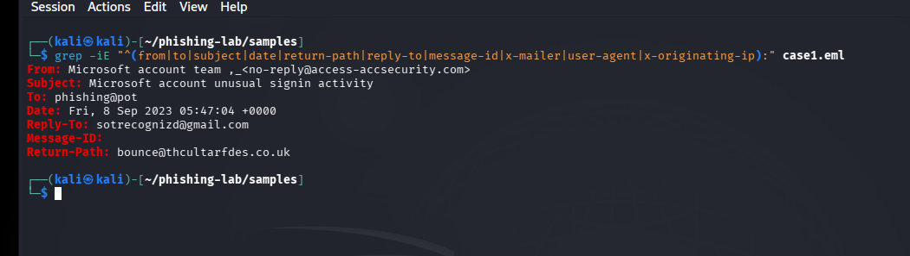 **PH-03** Case 1: three different domains | 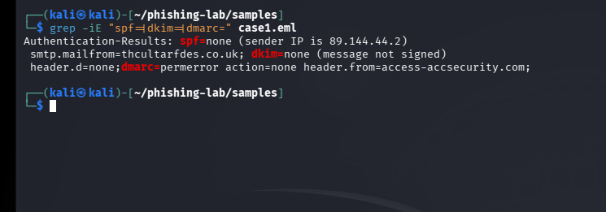 **PH-04** Case 1: SPF/DKIM/DMARC all fail |
| 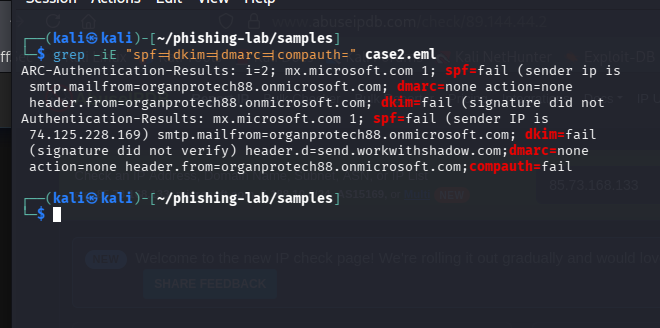 **PH-05b** Case 2: four different stories | 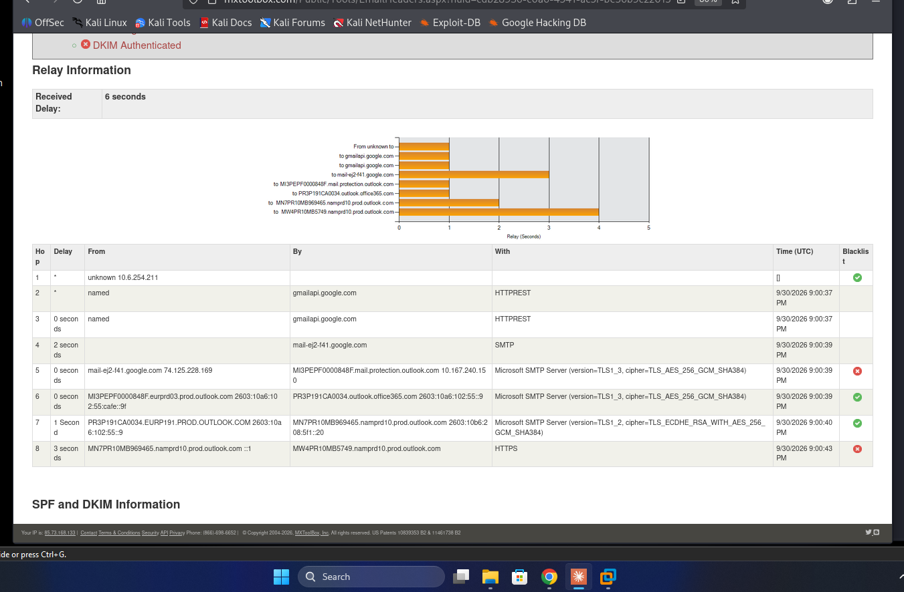 **PH-06** Case 2: Received chain (MXToolbox) |
| 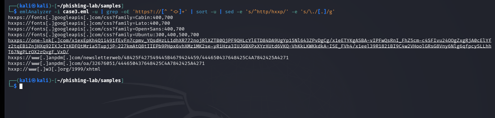 **PH-07** Case 3: extracted URLs, defanged | 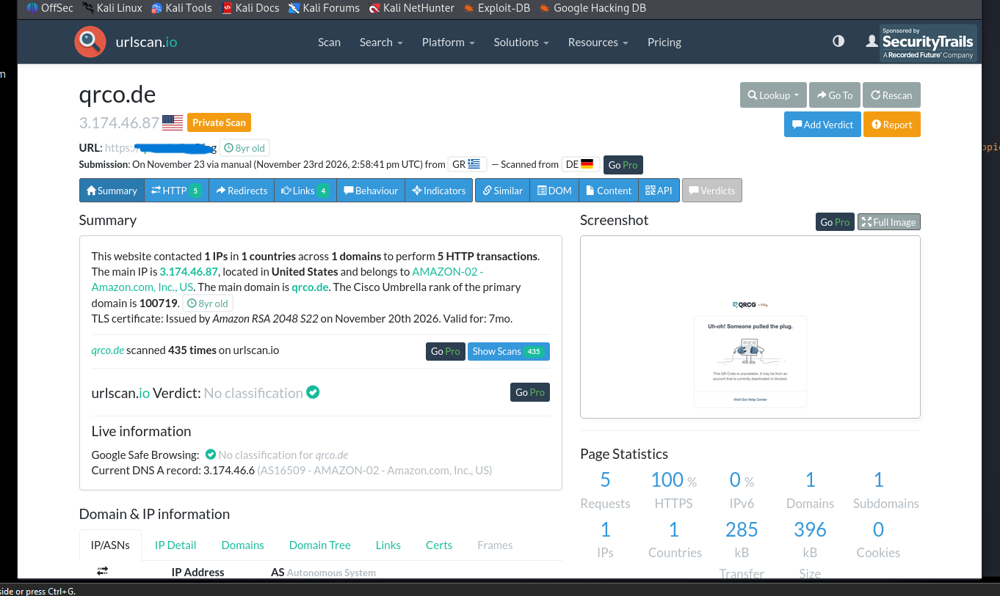 **PH-10b** Case 4: QR short link blocked by the service |

<details>
<summary>More screenshots</summary>

| | |
|---|---|
| 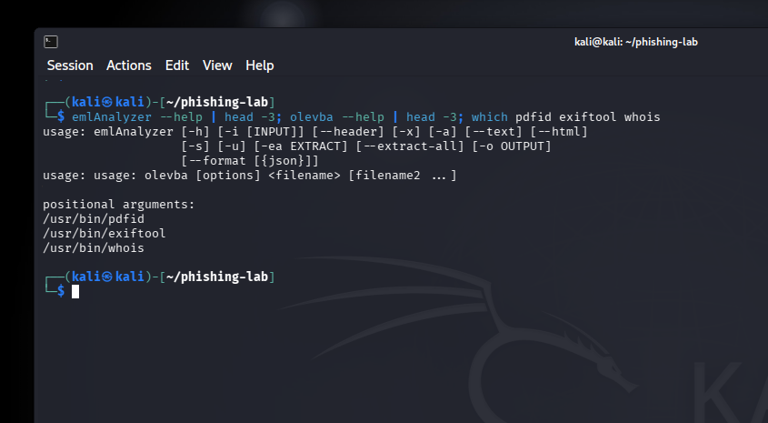 **PH-01** Tools installed | 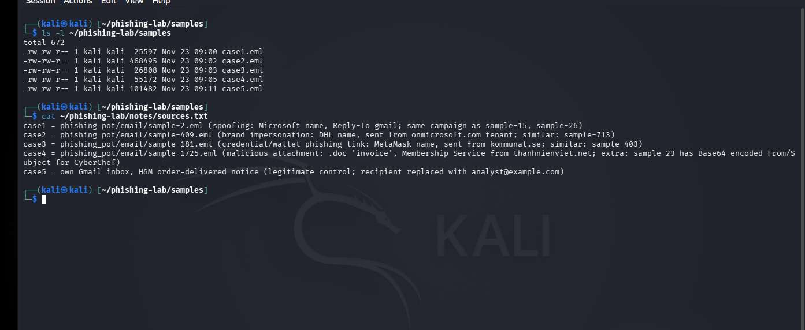 **PH-02** The five case files and their sources |
| 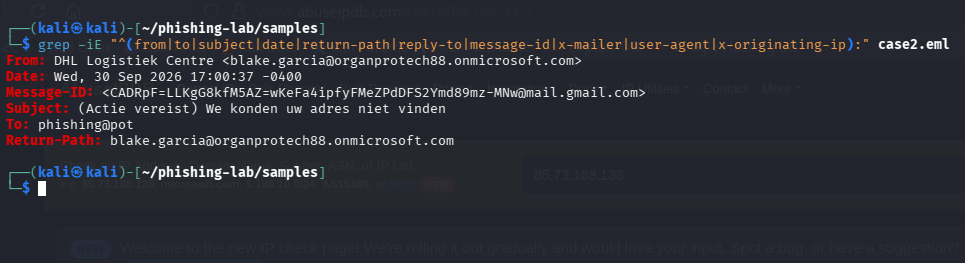 **PH-05** Case 2: key fields | 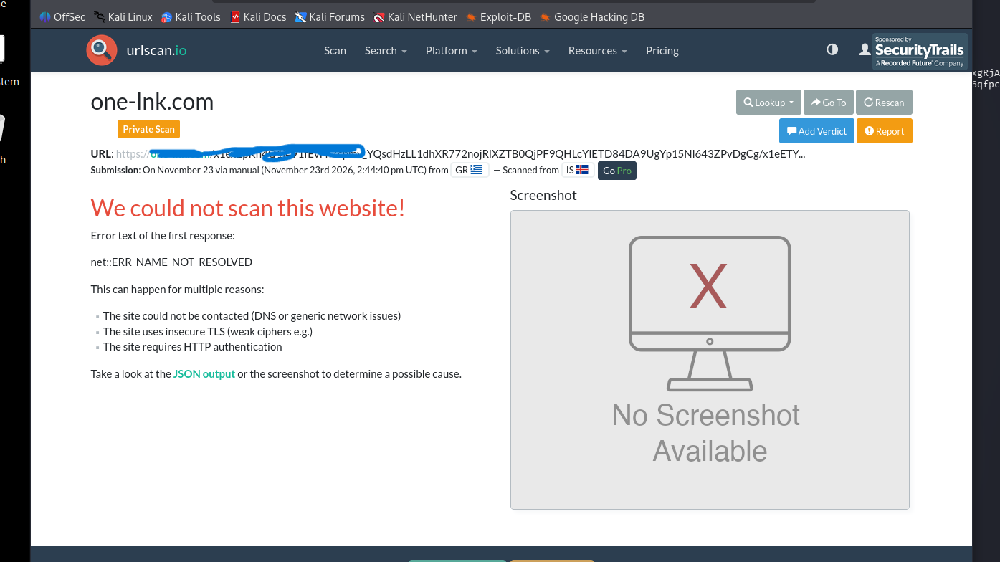 **PH-08** Case 3: private URLScan, link dead |
| 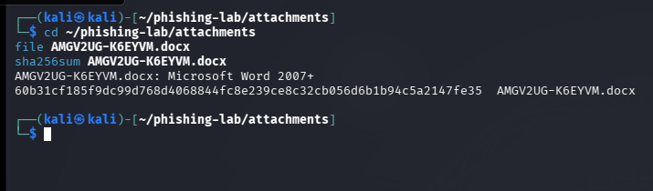 **PH-09** Case 4: file type and SHA-256 | 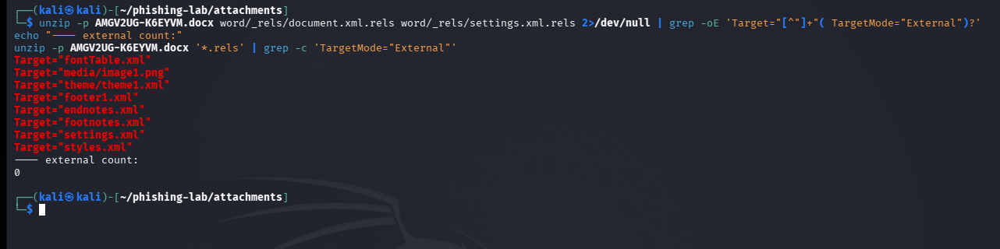 **PH-10** Case 4: no external relationships |
| 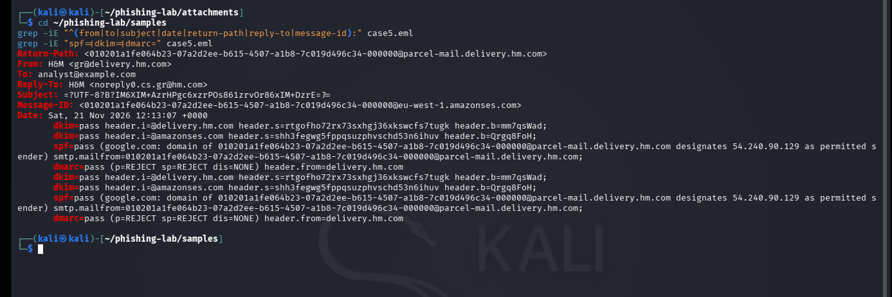 **PH-11** Case 5: everything aligned | 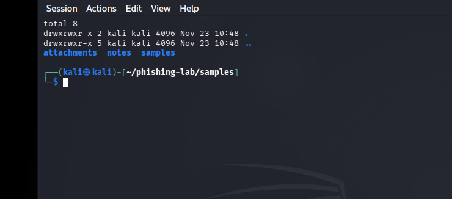 **PH-12** Cleanup before VM revert |

</details>

---

Samples: [rf-peixoto/phishing_pot](https://github.com/rf-peixoto/phishing_pot) (real phishing emails collected by honeypots). Analysis date: November 2026.
